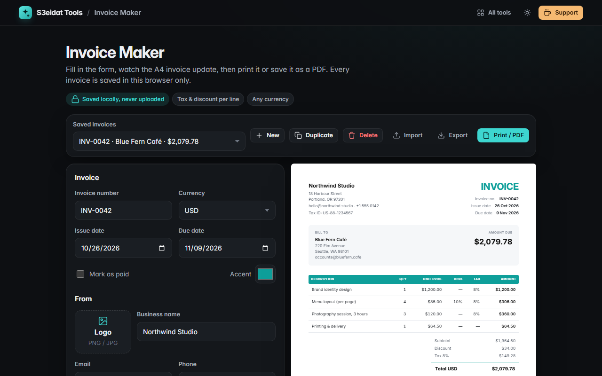

# Invoice Maker

> Clean, professional invoices you can print or save as PDF. Free, private, and it runs entirely in your browser.

### ▶ [Open Invoice Maker](https://s3eidat.github.io/invoice-maker/)



## Features

- Your business details, **logo upload**, tax/VAT ID, and client details
- Invoice number, issue date and due date; **New** auto-increments the number (`INV-0099` → `INV-0100`)
- Line items with quantity, unit price, **discount %** and **tax %** per line
- Totals with a tax breakdown per rate, rounded per line to the currency's minor unit (2 decimals for USD, 3 for JOD/KWD, 0 for JPY)
- 30+ currencies, an accent colour, and a **Paid** stamp
- Notes and payment terms
- **Live A4 preview**; **Print / PDF** prints only the invoice (use "Save as PDF" in the print dialog)
- Every invoice is **saved in this browser**; switch between them, **duplicate**, delete with undo
- **Export / import JSON** to back up or move your invoices (imported files are validated field by field)

## Privacy

Your invoices never leave your device. They are stored in your browser's localStorage, with no server,
no account and no analytics. The page ships with a strict Content-Security-Policy (`connect-src 'self'`),
so the browser itself blocks any attempt to send data anywhere. Clearing your browser data deletes them,
so use **Export** to keep a backup.

## Run it yourself

It's plain HTML, CSS and JavaScript with no build step:

```bash
git clone https://github.com/s3eidat/invoice-maker
cd invoice-maker
python -m http.server 8000
```

Then open http://localhost:8000.

## Support

If this saved you time, **[buy me a coffee ☕](https://s3eidat.github.io/coffee/)**. It keeps every tool free.

---

Part of **[S3eidat Tools](https://s3eidat.github.io/)**: 100+ free, private tools that run in your browser. MIT licensed.
